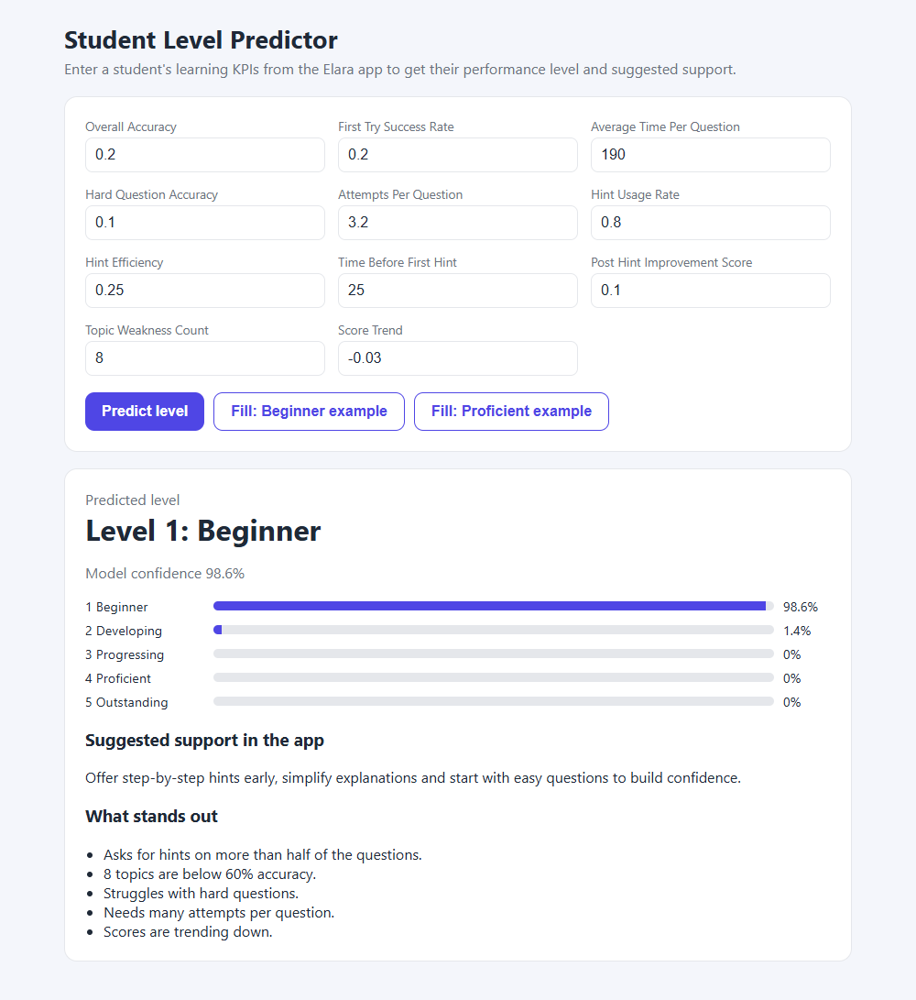
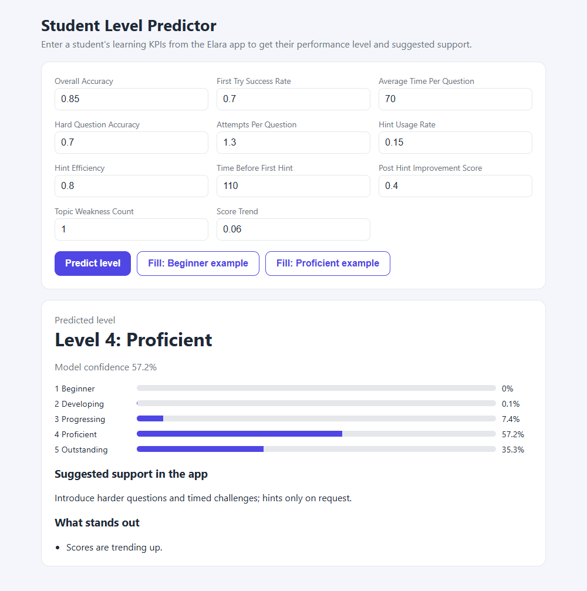
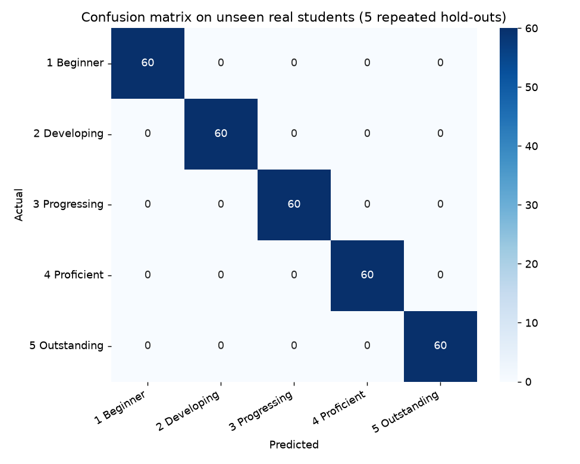
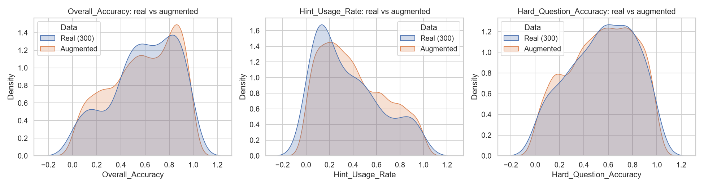

# Student Performance Classification for Elara Mobile App

A **Random Forest** that classifies students into **five performance levels** from 11 learning KPIs collected in the
Elara mobile app. The level drives adaptive support: hints, simplified explanations or harder challenges.

| Beginner | Proficient |
|---|---|
|  |  |

## Levels

| Label | Level | Description |
|---|---|---|
| 1 | Beginner | New to the topic, low accuracy, high hint usage, slow or negative progress |
| 2 | Developing | Understands the basics, solves simple questions, occasional hints |
| 3 | Progressing | Solves most questions, good accuracy, few hints |
| 4 | Proficient | Strong student, high accuracy, handles hard questions |
| 5 | Outstanding | Top performance across topics, rarely needs help |

The **Score Trend** shows improvement or decline over time but does not decide the label alone; all KPIs count.

## KPIs (model inputs)

| Feature | Meaning | Calculation |
|---|---|---|
| Overall Accuracy | Share of correct answers | `correct / attempts` |
| First-Try Success Rate | Correct on the first attempt | `first_attempt_correct / attempts` |
| Average Time per Question | Time per question, excluding hints | `answer_submitted_at - question_opened_at - hint time` |
| Hard Question Accuracy | Accuracy on "Hard" questions | `correct_hard / total_hard` |
| Attempts per Question | Average attempts before correct/abandon | mean of max attempt per question |
| Hint Usage Rate | Questions where a hint was requested | `questions_with_hint / attempted` |
| Hint Efficiency | Correct after using a hint | `correct_after_hint / hint_requests` |
| Time Before First Hint | Average wait before asking for a hint | `hint_requested_at - question_opened_at` |
| Post-Hint Improvement Score | Improvement after hints | `correct_after_hint - correct_before_hint` rate |
| Topic Weakness Count | Topics with accuracy below 60% | count of weak topics |
| Score Trend | Learning velocity | slope of a linear fit of score over time |

## Results

Evaluation is done on **real students the model has never seen**, repeated with 5 different splits (60 held-out
students each, 300 predictions in total).

| Test | Accuracy |
|---|---|
| Unseen real students | **100%** (same without augmentation) |
| Noisy / contradictory profiles of unseen students, trained **with** augmentation | **86.1%** |
| Same noisy profiles, trained **without** augmentation (300 rows only) | 70.4% |
| Random split of all augmented rows (for reference) | 85.6% |



How to read this:

- The 300 real records are almost perfectly separable, so even a model trained on 300 rows gets 100% on new real
  students. The labels were assigned from the same KPIs, so the model recovers the labelling rules; validating on students
  labelled independently (teacher grades, exam results) is the natural next step.
- Augmentation does not raise the accuracy on clean records. Its value is **robustness**: with realistic noise and
  contradictory profiles the augmented model keeps 86% while the 300-row model drops to 70%.
- The 90,000 augmented rows are noisy copies of 300 students. A random split of that file would place copies of the
  same student on both sides; the evaluation here augments **after** splitting, so no copy of a test student appears in
  training.

## Data

- `data/Elara_Student_Features.csv`: 300 real records (60 per level) with the 11 KPIs and the level.
- `data/Student_KPIs_Elara_Augmented.csv`: 90,000 rows generated by `src/data_augmentation.py` (seeded, so it is reproducible).

Augmentation, tuned to **prevent overfitting**:

- Gaussian noise on every KPI (1.5x the base scale), truncated to valid ranges.
- Random shocks on Score Trend (10% of rows).
- About 12% contradictory profiles (for example high accuracy with heavy hint use, or low accuracy with fast answers).
- About 2% outliers.
- 3% of augmented rows get a label moved to a neighbouring level (boundary noise), so the model cannot memorise
  the exact rules behind the 300 labels.
- A regularised forest (`max_depth=10`, `min_samples_leaf=5`, `max_features="sqrt"`): training accuracy on the noisy
  data is 88%, and 86% on noisy unseen students, so there is no large train/test gap.



More figures: [level distribution](img/Student-KPIs-/eda_level_distribution.png),
[correlation](img/Student-KPIs-/eda_correlation.png), [box plots](img/Student-KPIs-/eda_boxplots.png),
[feature importance](img/Student-KPIs-/feature_importance.png).

## Project structure

```
├── config.py                  # paths, features, noise settings
├── run_pipeline.py            # augmentation -> EDA -> training in one command
├── app.py                     # small Flask demo
├── templates/index.html
├── src/
│   ├── data_augmentation.py   # noisy synthetic records
│   ├── eda.py                 # figures
│   ├── train.py               # evaluation + final model
│   └── predictor.py           # level prediction + support suggestions
├── data/                      # real and augmented CSV files
├── models/                    # student_level_rf_model.pkl, metrics.json
└── img/                       # screenshots and figures
```

## Setup and run

```bash
pip install -r requirements.txt
python app.py        # demo at http://127.0.0.1:5000
python run_pipeline.py   # rebuild data, figures and model
```

## License

MIT License
